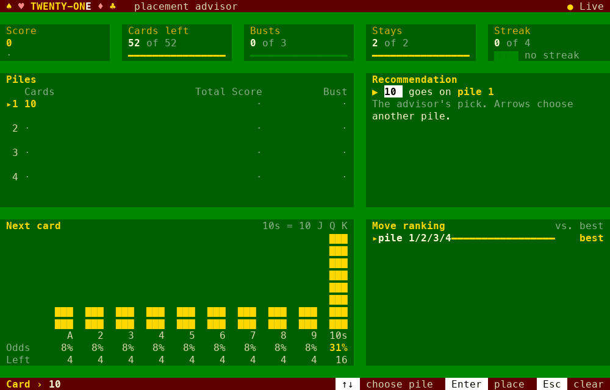
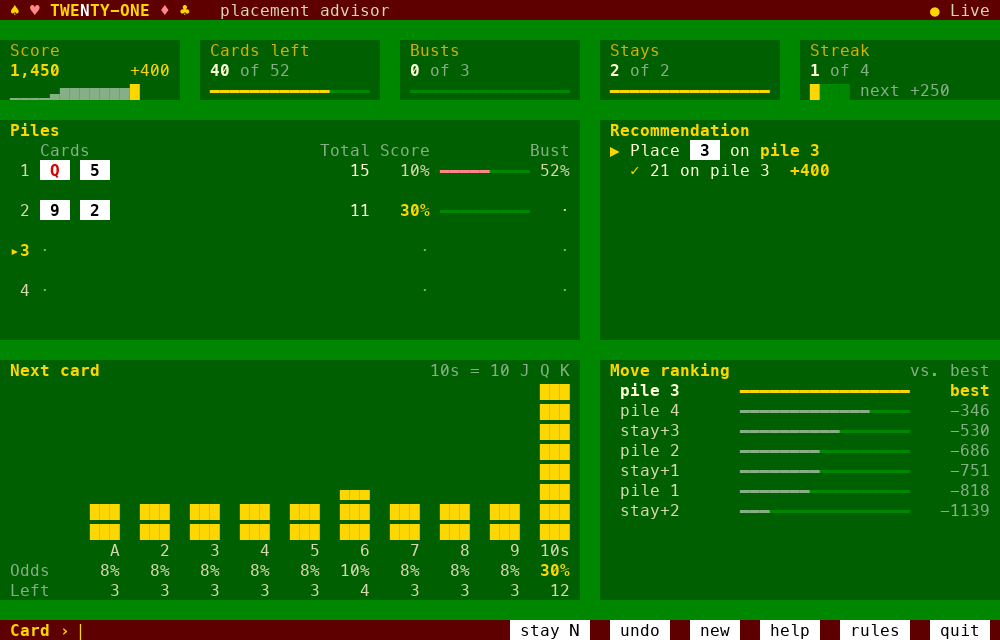
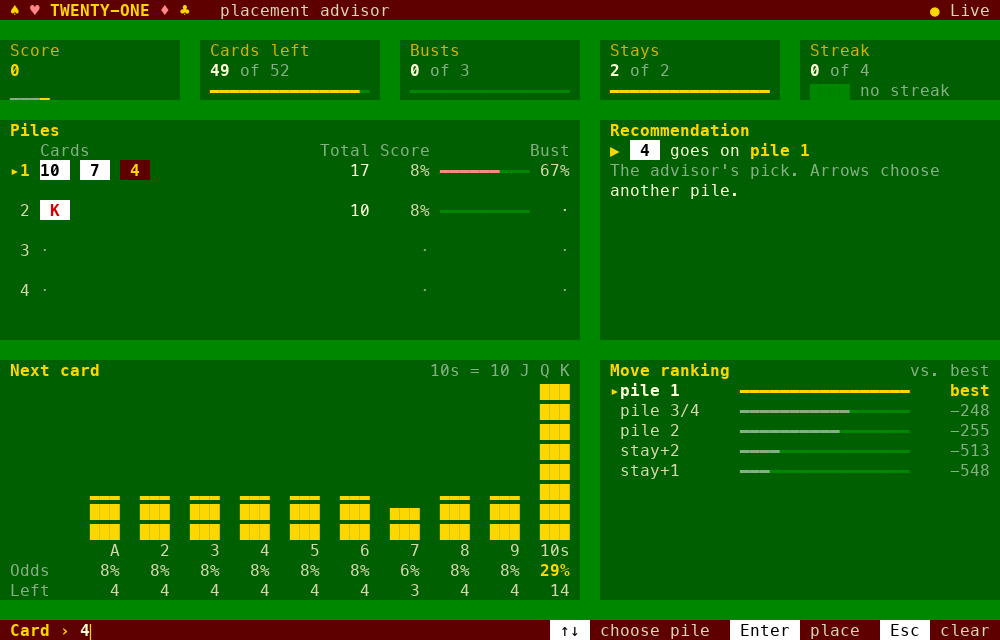
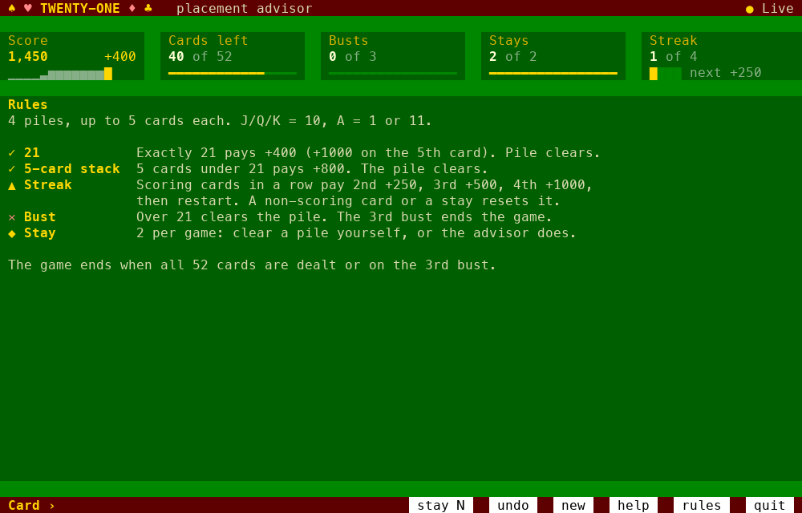
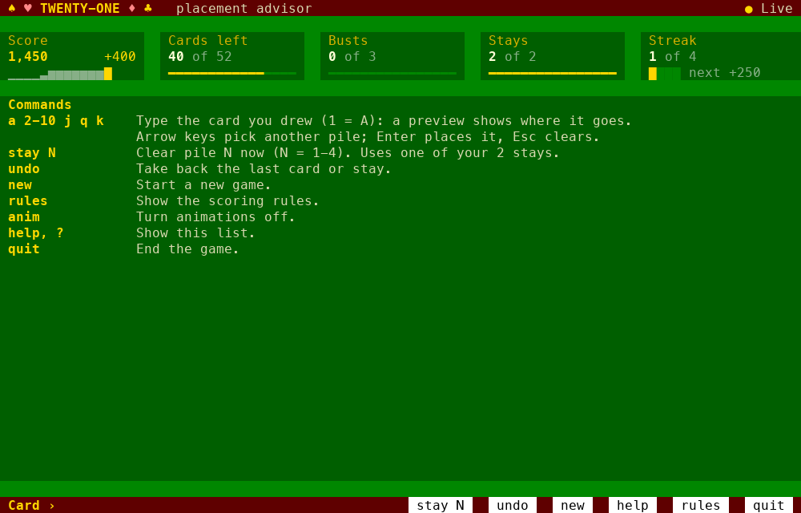
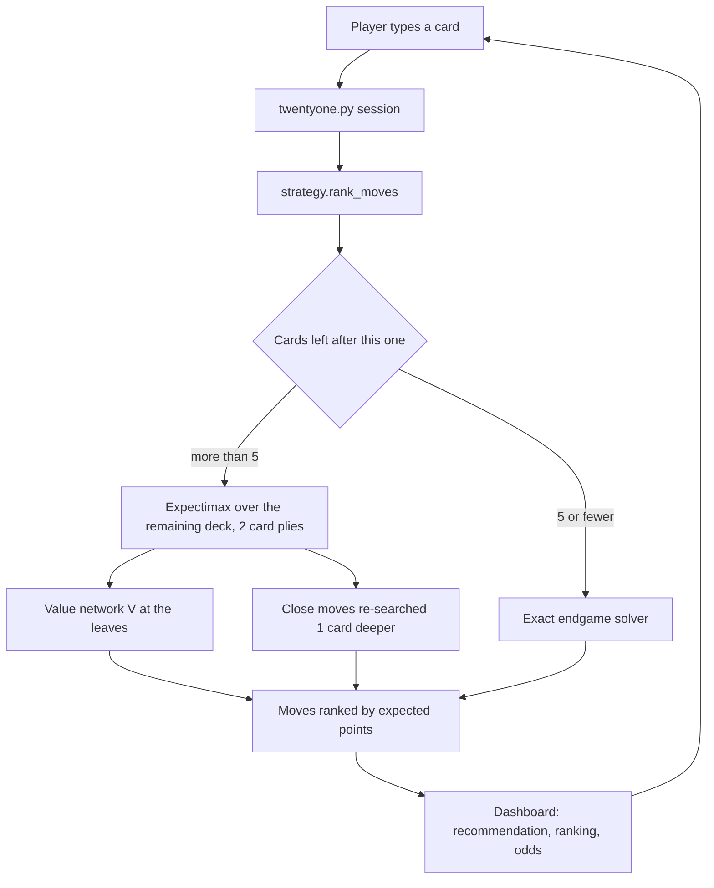

# 21


_Self--Play-green)


21 is a terminal placement advisor for the "21" solitaire card game: you type each card as it's dealt and it tells you which of the four piles to put it on.
Behind the dashboard is an expectimax search over the exact remaining deck, with a small neural network trained by self-play scoring the positions it can't search to the end, and an exact solver that plays the last few cards perfectly.

---

## Table of Contents

- [Features](#Features)
- [Demo](#Demo)
- [Project Story](#Project-Story)
- [Results & Impact](#Results--Impact)
- [Tech Stack](#Tech-Stack)
- [Architecture](#Architecture)
- [Getting Started](#Getting-Started)
- [Usage](#Usage)
- [Folder Structure](#Folder-Structure)
- [Author](#Author)
- [Acknowledgments](#Acknowledgments)

---

## Features

- Best-move advice: Ranks every legal placement (each pile, with or without a stay) by expected points for the rest of the game.
- Live preview: Shows the recommendation as you type a card; the arrow keys pick a different pile and Enter places it.
- Card counting: Tracks every card seen and shows the odds of each rank coming next, plus each pile's chance to score or bust.
- Full scoring rules: 21s, 5-card stacks, busts, stays, scoring streaks (+250/+500/+1000) and the +1000 perfect-game bonus.
- Exact endgame: With 5 or fewer cards left, an exact solver replaces the network, so the last moves are provably optimal.
- Undo and new game: Step back through any move, or start over at any time.
- Dashboard UI: Full-screen, color terminal dashboard with score tiles, animations and built-in help and rules panels.

---

## Demo


The dashboard mid-game: score tiles across the top, the piles with each one's score and bust chances, the recommendation, the odds of the next card and every move ranked against the best.



Typing a card previews the advisor's pick before you place it:



Built-in rules and commands:

 

---

## Project Story

21 started as a simple calculator: type a card, get a pile. The first version used a one-card lookahead heuristic. From there the strategy was improved through rounds of benchmarked experiments, each candidate measured on the same decks as the incumbent:

- Several approaches were built side by side and compared head to head: a tuned structural heuristic, Monte Carlo rollouts, expectimax with fitted leaf values, and a learned value function.
- The learned value function won and became the app's strategy, with an exact endgame solver added on top.
- As the game's scoring grew (scoring streaks, then a perfect-game bonus), the rules were added to the game, the search, the endgame solver and the network's training, and the network was retrained by self-play each time.

Every number below comes from held-out decks (seeds never used for tuning), and the full experiment log, including what didn't help, is in [RESULTS.md](RESULTS.md).

---

## Results & Impact

On held-out decks, same decks for every strategy (details in [RESULTS.md](RESULTS.md)):

- **Original rules:** the learned value function with the exact endgame averages **6,826** points per game against **5,865** for the original heuristic, **+961 (+16%)**. It reaches the end of the deck in 98.4% of games instead of 94.8%.
- **With scoring streaks:** **8,383** against **6,587** for the original heuristic. Deeper search on close moves alone added **+136 ± 44** per game.
- **With the perfect-game bonus (current rules):** making the search bonus-aware and retraining the network raised the average from **8,563** to **9,008**, **+445 ± 56** per game, with 99.6% of games finishing the deck.
- About 60–70 ms per move on a laptop, fast enough to use live.
- What was tried and dropped is recorded too: expectimax with fitted leaves (−322 ± 60 against the tuned heuristic), solving the endgame from 6 cards (+12 ± 11 at 10× the time), and further network fine-tuning (no gain).

---

## Tech Stack

**Strategy & AI**:
- Expectimax search over the exact remaining-deck distribution
- NumPy MLP value network trained by TD(λ) self-play
- Memoized exact endgame solver
- Paired held-out benchmarking with multiprocessing

**Application**:
- Python
- NumPy
- ANSI terminal UI (256-color, full-screen, raw-key input)

**Dev tools**:
- Claude Code
- Git & GitHub

---

## Architecture

**Flow**:
- The player types the card that was dealt; the game model tracks piles, busts, stays, the streak and every card seen.
- The strategy scores each legal move: immediate points plus the expected value of the position after it, searched two cards ahead over the exact remaining deck.
- Positions at the edge of the search are scored by a small neural network trained by self-play; moves within 200 points of the best are searched one card deeper.
- With 5 or fewer cards left, an exact solver plays out every remaining possibility instead.
- The dashboard shows the best move, every alternative's cost against it, and the odds for the next card. If `strategy/` is missing, the app falls back to its built-in heuristic.

---

## Getting Started

1. Clone the repository
```bash
git clone https://github.com/cjr03/21.git
cd 21
```
2. Create a virtual environment and install dependencies
```bash
python3 -m venv .venv
.venv/bin/pip install -r requirements.txt
```
3. Run the advisor (in a terminal at least 78 columns wide)
```bash
.venv/bin/python twentyone.py
```

Developed and tested on macOS with Python 3.14.

---

## Usage

- Type each card as it's dealt (`a`, `2`–`10`, `j`, `q`, `k`). The recommendation updates as you type.
- Press Enter to place it on the recommended pile, or use the arrow keys to choose another pile first.
- `stay N` uses a stay on pile N, `undo` takes back the last action, `new` starts a new game.
- `help` and `rules` open the reference panels; `anim` toggles animations; `quit` exits.
- Benchmark a strategy on held-out decks:
```bash
.venv/bin/python opt/bench.py strategy/strategy.py --games 500 --start 100000
```
- Retrain the value network: `opt/cand_valuefn/train.py` (see [RESULTS.md](RESULTS.md) for the recipes used).

---

## Folder Structure

```plaintext
21/
├─ twentyone.py            # the game model, rules and terminal dashboard
├─ strategy/               # the strategy the app uses
│  ├─ strategy.py          # expectimax search + deeper re-search of close moves
│  ├─ vf_core.py           # value network and its game model
│  ├─ endgame.py           # exact endgame solver
│  └─ weights.npz          # trained network weights
├─ opt/                    # experiments and benchmarks
│  ├─ bench.py             # paired benchmark harness
│  ├─ baseline.py          # the original heuristic
│  ├─ cand_valuefn/        # learned value function (training, weights, logs)
│  ├─ cand_tuned/          # tuned structural heuristic
│  ├─ cand_rollout/        # Monte Carlo rollout strategy
│  ├─ cand_expectimax/     # expectimax with fitted leaf values
│  └─ heldout_*.txt        # raw held-out benchmark output
├─ docs/                   # screenshots and demo
├─ RESULTS.md              # full experiment log
├─ requirements.txt
└─ README.md
```

---

## Author

**Cole Roberts**

*M.S. Artificial Intelligence, Santa Clara University*

Email: cole03roberts@gmail.com

LinkedIn: https://www.linkedin.com/in/cole03roberts/

---

## Acknowledgments

Built with Claude Code.
